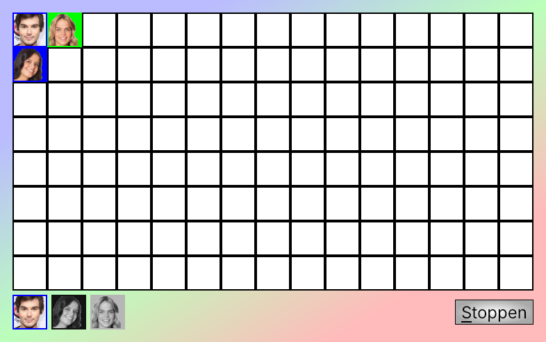

# K3-Op-Een-Rij

K3-themed game of connect-three programmed in C++ using Qt
(see [About](about.md) for more details)
and one of
[Richèl Bilderbeek's games](https://richelbilderbeek.github.io/games).

- [Play the game in your browser](play.md)
- [Screenshots](screenshots/README.md)
- [About](about.md)
- [Building](build.md)
- [Contributing](CONTRIBUTING.md)
