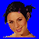
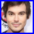

# K3-Op-Een-Rij FAQ

## How do you spell the name of this game

'K3-Op-Een-Rij', i.e. all capitals and dashes between the words.
The repository uses `k3_op_een_rij`.

## Who are these images?

Image                                       |Name
--------------------------------------------|---------------------
               | David
    | Hanne Verbruggen
       | Josje Huisman
         | Karen Damen
   | Kathleen Aerts
    | Klaasje Meijer
   | Kristel Verbeke
                 | Matt
 | Marthe De Pillecyn
               | Tyler

## Why the male images?

Because gender equality.

## How were the male images selected?

This was done by a randomly sampled female.
